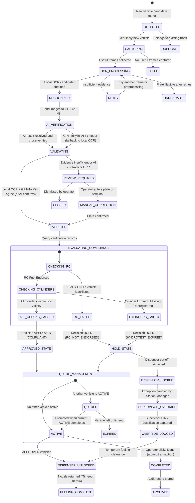

# Application Workflow & System Journey (AppFlow)

**Project Name:** SmartFuel — Commercial Enterprise CNG Dispensing & Safety Management Automation Platform  
**Developer & Provider:** SmartFuel Technologies Pvt. Ltd.  
**Document Reference:** SF-ENT-FLOW-2026-V4.0  
**Status:** Production Deployed (`https://fuel.cscsetu.com`)  
**Classification:** Proprietary / Commercial B2B  
**Changelog:** V4.0 adds GPT-4o Mini Vision API double verification for AI-powered plate number confirmation. V3.0 incorporated CNG Connect Complete Vehicle Recognition & Queue Management Logic (Version 1.0, 15 Oct 2026).

---

## 1. Overall Workflow

The system follows a continuous, event-driven pipeline from camera observation to operator completion:

```
CONTINUOUS CAMERA MONITORING
    ↓
AUTOMATIC VEHICLE DETECTION (assign unique Event ID)
    ↓
CAPTURE MULTIPLE FRAMES (3–5 useful plate images)
    ↓
LOCAL OCR RECOGNITION (Tesseract/PaddleOCR on best frames)
    ↓
🤖 GPT-4o MINI DOUBLE VERIFICATION (send plate images to AI Vision API)
    ↓
CROSS-VERIFICATION (compare local OCR vs GPT-4o Mini → determine final plate)
    ↓
PLATE VALIDATION (Indian format check + multi-frame + AI agreement)
    ↓
VEHICLE DATABASE LOOKUP (registration, cylinder & hydrotest records)
    ↓
VEHICLE QUEUE MANAGER (ACTIVE / QUEUED ordering)
    ↓
ACTIVE VEHICLE DASHBOARD (display one vehicle at a time)
    ↓
OPERATOR CLICKS DONE (complete transaction, advance to next vehicle)
```

### 1.1 Core Operating Rules

| Rule | Description |
| :--- | :--- |
| **Continuous Observation** | The camera keeps detecting new vehicles even while the operator works on one ACTIVE vehicle. |
| **Queue Isolation** | New vehicles are prepared in the background and never overwrite the active vehicle. |
| **Atomic Completion** | After Done is accepted by the backend, the oldest eligible queued event becomes ACTIVE. |
| **Event Isolation** | The system must never mix the images, OCR results, verification data, or completion status of different vehicles. |

---

## 2. End-to-End System Operational Journey

The core operational workflow governs the transition from physical vehicle ingress at a CNG station dispenser island to automated safety verification, physical dispenser solenoid interlock actuation, and permanent audit logging.

```mermaid
sequenceDiagram
    autonumber
    actor Driver as Vehicle Driver
    participant Cam as Island ANPR Camera
    participant Edge as Station Edge Gateway
    participant GPT as GPT-4o Mini Vision API
    participant Cloud as SmartFuel Cloud Core
    participant Queue as Queue Manager
    participant Compliance as Compliance & Verification Engine
    participant Disp as Island Display (/cng-display)
    participant Relay as Dispenser Solenoid Relay
    actor Attendant as Forecourt Attendant

    Note over Cam: Continuous RTSP Stream (25 FPS)
    Driver->>Cam: Pulls vehicle into Dispenser Bay
    Cam->>Edge: Vehicle Detection & Tracking
    Note over Edge: Assign unique Event ID<br/>Track vehicle across frames<br/>Duplicate detection (same track = same event)
    Edge->>Edge: Capture 3–5 useful plate frames
    Note over Edge: Quality Gate: reject blurred,<br/>tiny, or poorly lit frames
    Edge->>Edge: Local OCR (Tesseract/PaddleOCR) on best frames
    Note over Edge: Compare local OCR readings across frames
    
    Edge->>GPT: Send best plate images for AI verification
    Note over GPT: GPT-4o Mini Vision API analyzes<br/>plate images and returns the<br/>actual correct vehicle number
    GPT-->>Edge: AI-verified plate number + confidence
    
    Note over Edge: CROSS-VERIFICATION:<br/>Compare local OCR vs GPT-4o Mini result<br/>If both agree → HIGH confidence final plate<br/>If disagree → GPT-4o Mini result preferred<br/>(AI has superior context understanding)
    
    Edge->>Cloud: POST /api/v1/edge/scan (Plate, Frames, OCR + GPT-4o Mini results, Event ID)
    Note over Cloud: Duplicate Suppression Check (180s)
    Cloud->>Queue: Create vehicle event (QUEUED or ACTIVE)
    Note over Queue: If no ACTIVE event → new event becomes ACTIVE<br/>Otherwise → event enters QUEUED state
    Cloud->>Compliance: Dual Verification Query (Final Verified Plate)
    Compliance-->>Cloud: Vehicle Records (Fuel Endorsement) + Cylinder Records (Hydrotest Validity)
    Note over Cloud: Compliance Decision Engine Evaluates Safety Rules
    
    alt Both Checks Pass (Compliant)
        Cloud-->>Edge: Decision = APPROVED
        Edge->>Disp: Display GREEN (APPROVED / अनुमत)
        Edge->>Relay: Energize Solenoid Relay (UNLOCK 24V)
        Attendant->>Driver: Connects Nozzle & Dispenses CNG
    else Either Check Fails (Expired / Non-Endorsed)
        Cloud-->>Edge: Decision = HOLD
        Edge->>Disp: Display RED (HOLD / रोका गया + Reason)
        Edge->>Relay: De-energize Relay (CUT SOLENOID POWER)
        Attendant->>Driver: Refuses Fueling; Directs to Safety Office
    else Uncertain Plate / AI Disagreement
        Cloud-->>Edge: Decision = UNDER REVIEW
        Edge->>Disp: Display AMBER (REVIEW / समीक्षा)
        Edge->>Relay: Maintain Interlock (LOCKED)
        Attendant->>Attendant: Verifies plate manually on Station Terminal
    end
    
    Attendant->>Cloud: Clicks DONE on Operator Dashboard
    Note over Cloud: Atomic Transaction:<br/>1. Verify event is ACTIVE<br/>2. Save completion timestamp<br/>3. Mark COMPLETED<br/>4. Select oldest eligible QUEUED event<br/>5. Promote to ACTIVE
    Cloud-->>Disp: Display next ACTIVE vehicle (already prepared)
    Cloud->>Cloud: Write Cryptographic Audit Ledger & Event Log
```

---

## 3. Vehicle Recognition & Detection Pipeline

### 3.1 Continuous Vehicle Detection Logic

The camera service runs continuously — it does **not** pause while the operator handles the current ACTIVE vehicle.

```
1. Read the next camera frame
2. Detect vehicles and plate candidates
3. Match each candidate against existing tracks
4. If it belongs to an existing track → update that event (no duplicate)
5. If genuinely new → create a unique vehicle event
6. Capture useful frames and start recognition asynchronously
7. If another vehicle arrives → create another event without replacing the current ACTIVE event
```

### 3.2 Dual-Engine Recognition Pipeline (Local OCR + GPT-4o Mini)

The system uses a **two-stage recognition architecture**: fast local OCR for initial readings followed by GPT-4o Mini Vision API for AI-powered double verification to determine the actual correct vehicle number.

```
[Camera Frame] → [Quality Gate]
                      ↓
              Reject: blurred, tiny, blocked, poorly illuminated
                      ↓
              [Best-Frame Ranking] → Select 3–5 clearest useful frames
                      ↓
     ┌────────────────┴────────────────┐
     ↓                                ↓
[STAGE 1: Local OCR]          [STAGE 2: GPT-4o Mini Vision API]
Tesseract / PaddleOCR          Send best plate images to
Run on each frame              OpenAI GPT-4o Mini via API
     ↓                                ↓
[Local OCR candidates]         [AI-verified plate number]
(e.g., 3 readings from         (GPT-4o Mini reads the images
 3 frames)                      and returns the actual correct
     ↓                          vehicle registration number)
     └────────────────┬────────────────┘
                      ↓
              [CROSS-VERIFICATION ENGINE]
              Compare local OCR majority vs GPT-4o Mini result:
              • Both agree → ✅ HIGH CONFIDENCE (proceed)
              • Disagree → GPT-4o Mini preferred (superior context)
              • GPT-4o Mini unavailable → fall back to local OCR consensus
                      ↓
              [Normalization] → Uppercase, remove spaces/hyphens
                      ↓
              [Indian Plate Format Validation] → HSRP & BH regex filter
                      ↓
              [Final State: VERIFIED / REVIEW_REQUIRED / UNREADABLE]
```

### 3.3 GPT-4o Mini Vision API Integration

The GPT-4o Mini Vision API acts as the authoritative **double verification** engine:

1. **Input:** The 3–5 best-quality plate images captured from the vehicle event are sent as base64-encoded images to the OpenAI API.
2. **Prompt:** A structured prompt asks GPT-4o Mini to read the vehicle registration number visible in the images and return the exact plate text.
3. **Output:** GPT-4o Mini returns the recognized plate number along with its analysis.
4. **Cross-Verification:** The system compares the GPT-4o Mini result against the local OCR consensus:
   - If GPT-4o Mini agrees with the local OCR majority → plate is confirmed with HIGH confidence.
   - If GPT-4o Mini disagrees → the GPT-4o Mini reading is preferred (it has superior contextual understanding of partial/damaged/dirty plates).
   - If GPT-4o Mini API is unreachable → the system falls back to local OCR consensus with reduced confidence.

### 3.4 Multi-Frame + AI Agreement Example

| Source | Reading | Notes |
| :--- | :--- | :--- |
| Local OCR Frame 1 | WB02AB1234 | Tesseract confidence: 94% |
| Local OCR Frame 2 | WB02AB1234 | Tesseract confidence: 91% |
| Local OCR Frame 3 | WB02A81234 | Tesseract confidence: 78% (misread B→8) |
| **GPT-4o Mini** | **WB02AB1234** | **AI confirms correct plate from image analysis** |
| **Final Decision** | **WB02AB1234** | Local OCR majority (2/3) + GPT-4o Mini agree → VERIFIED |

| Scenario | Local OCR | GPT-4o Mini | Final Plate | Confidence |
| :--- | :--- | :--- | :--- | :--- |
| Both agree | WB02AB1234 | WB02AB1234 | WB02AB1234 | HIGH (dual-confirmed) |
| Disagree — AI preferred | WB02A81234 | WB02AB1234 | WB02AB1234 | MEDIUM (AI override) |
| GPT-4o Mini API down | WB02AB1234 | *(unavailable)* | WB02AB1234 | REDUCED (OCR-only fallback) |
| Both unreadable | *(unreadable)* | *(unreadable)* | — | REVIEW_REQUIRED |

### 3.5 AI Confidence Rule

Neither the local OCR engine's confidence score nor GPT-4o Mini's response alone constitutes ground truth. The true verification decision is a **composite of all available signals**:

```
Local OCR results + GPT-4o Mini AI verification + image quality + cross-frame agreement + format validation + trusted vehicle-record lookup = final verification decision
```

---

## 4. Vehicle Inspection State Machine

The verification lifecycle transitions through strictly deterministic states. No vehicle may reach `APPROVED` without satisfying both registration fuel endorsement and 3-year hydrostatic cylinder validity rules.



---

## 5. Vehicle Queue Management

### 5.1 Queue Behavior Matrix

| Situation | Required Behavior |
| :--- | :--- |
| **Car 1 arrives** | Create Event A. If no active event exists, A becomes ACTIVE. |
| **Car 2 arrives during Car 1** | Create Event B. Recognize/prepare it in background and place it in QUEUED. |
| **Car 3 arrives** | Create Event C behind B. |
| **Car 1 remains active** | Never replace its ACTIVE card with B or C. |
| **Car 1 Done** | Atomically complete A and promote the oldest eligible queued event, normally B. |
| **Car 2 becomes active** | Display its already prepared data automatically; no new scan is required. |
| **Car 4 arrives** | Append a new event while Car 2 remains active. |

### 5.2 Done Button — Atomic Backend Transaction

The Done button is a workflow transition. It must send the active event ID to the backend, which verifies that the event is still ACTIVE before changing its state.

```
CHECK ACTIVE EVENT ID
    ↓
Confirm completion conditions
    ↓
Save completion timestamp and final status
    ↓
Mark current event COMPLETED
    ↓
Select oldest eligible QUEUED event
    ↓
Promote it to ACTIVE
    ↓
Return the new ACTIVE event to dashboard
```

> **Atomicity Rule:** The operation must be atomic so that double-clicks, refreshes, or multiple screens cannot create two ACTIVE vehicles.

---

## 6. Duplicate Protection

A vehicle can produce many frames while it remains in the capture zone. The system must not create a new database event for every frame.

- Keep **one event ID** while the same vehicle remains tracked.
- Store individual OCR observations **under that event**.
- Use vehicle tracking plus an **exit/timeout rule** to determine when it has left.
- Do **not** rely on plate text alone for deduplication because OCR can temporarily change.

---

## 7. Detailed Role-Based User Journeys

### 7.1 Journey A: Forecourt Attendant (On-Island Operation)
1. **Station Login:** Attendant authenticates via forecourt terminal or mobile tablet using Station ID and Operator PIN.
2. **Shift Assignment:** Selects assigned dispenser bay (e.g., *Island 2, Bay A & B*).
3. **Passive Surveillance:** Overhead monitor continuously runs `/cng-display` in full-screen mode, showing station readiness banner.
4. **Vehicle Arrival:** As a vehicle stops at the dispenser, the monitor updates within 1.2 seconds:
   - If **GREEN:** Attendant hears confirmation chime, verifies that the plate on screen matches physical vehicle, plugs nozzle, and begins dispensing.
   - If **RED:** High-intensity red alert shows specific failure reason (e.g., *Cylinder Expired: WB00DE0001*). Dispenser keypad remains unresponsive (solenoid locked). Attendant explains safety rejection to driver.
   - If **AMBER:** Attendant checks plate number on the companion handheld/wall tablet, taps *Confirm Plate* if OCR was slightly misread, or directs vehicle to supervisor.
5. **Queue Awareness:** The operator dashboard shows the ACTIVE vehicle prominently plus upcoming QUEUED vehicles below it. The attendant can see how many vehicles are waiting.
6. **Done Action:** When fueling is complete or a HOLD vehicle is handled, the attendant clicks **Done**. The system atomically completes the current event and promotes the next queued vehicle to ACTIVE — no manual rescan required.

---

### 7.2 Journey B: Station Safety Supervisor (Exception & Override Handling)
1. **Alert Notification:** Station Manager console alerts on an active `HOLD` incident.
2. **Inspection Review:** Supervisor inspects the live event in the portal (`/` or `/alerts/wall`):
   - Inspects vehicle ingress camera photo.
   - Inspects vehicle compliance records and registered chassis number.
   - Inspects cylinder testing history and certificate records.
3. **Driver Dispute Resolution:** Driver claims cylinder was recently tested and shows a physical paper certificate:
   - Supervisor cross-checks certificate QR code against accredited testing agency database.
   - If the certificate is genuine but pending central database synchronization:
     - Supervisor clicks **Initiate Emergency Manual Override**.
     - System prompts for: Mandatory Reason Code, Justification Notes, Photo upload of physical certificate, and Supervisor Digital PIN.
   - System unlocks dispenser for a single 15-minute dispensing session and issues an immediate critical audit entry to the Corporate CGD Safety Auditor.

---

### 7.3 Journey C: Corporate CGD Safety Auditor & Operations Director
1. **Enterprise Overview:** Accesses high-level analytics dashboard at `/analytics` and `/reports`:
   - Total vehicles scanned today across national franchise network.
   - Compliance Rate (% Approved vs % Rejected).
   - Top rejection causes (RC Not Endorsed vs Hydrotest Expired vs Blacklisted).
2. **Station Safety Ranking:** Views stations with highest violation attempts or abnormal supervisor override frequencies.
3. **Blacklist Propagation:** Adds a known counterfeit cylinder serial or stolen vehicle plate to the Enterprise Blacklist; all edge gateways synchronize within 60 seconds.
4. **Audit Export:** Generates official statutory compliance report PDF for corporate safety filings and insurance risk underwriting.

---

## 8. Operator Dashboard Layout

| Area | Display |
| :--- | :--- |
| **ACTIVE VEHICLE** | One vehicle only: plate, recognition state, verification status, arrival time, and transaction status. |
| **UPCOMING / QUEUE** | Ordered list of vehicles waiting behind ACTIVE. |
| **Recognition** | Candidate plate, quality/recognition state, and retry status. |
| **Verification** | VERIFIED / NO RECORD / DATA UNAVAILABLE / REVIEW REQUIRED as returned by backend. |
| **Done** | Completes current workflow and triggers next queued event. |
| **Camera** | Live connection and health status. |

---

## 9. Exception Handling & Safety Boundary

### 9.1 Exception States

| Exception | System Response |
| :--- | :--- |
| **Camera disconnected** | Show CAMERA_OFFLINE, retry connection and preserve the queue. |
| **Local OCR API unavailable** | Keep event pending/retry; never delete the event. |
| **GPT-4o Mini API unavailable** | Fall back to local OCR consensus with reduced confidence. Log API failure. Event proceeds but marked as `OCR_ONLY` (not dual-verified). |
| **GPT-4o Mini API rate limited** | Queue the verification request and retry after backoff. Do not block the pipeline. |
| **Local OCR vs GPT-4o Mini disagree** | GPT-4o Mini result is preferred. If confidence is still low, mark REVIEW_REQUIRED for operator confirmation. |
| **Plate unreadable by both engines** | Preserve all evidence images and mark UNREADABLE / REVIEW_REQUIRED. |
| **No vehicle record** | Show NO_RECORD_FOUND distinctly from OCR failure. |
| **Verification data unavailable** | Show DATA_UNAVAILABLE; missing data is not automatic success. |
| **Duplicate detection** | Attach observation to existing event. |
| **Two Done clicks** | Only first valid backend state transition succeeds. |
| **Browser refresh** | Restore ACTIVE and QUEUED state from backend. |

### 9.2 Safety Boundary

> **Critical Rule:** Unreadable plates, missing records, expired verification, or contradictory information should create defined exception states. Recognition software should not become a safety bypass. Any actual CNG dispensing authorization must remain under the station's approved control and safety architecture.

### 9.3 Operational Edge-Cases

| Operational Edge Case | Root Cause | Automated System Handling | Fail-Safe State |
| :--- | :--- | :--- | :--- |
| **Complete Network Outage** | Fiber cut / Telecom 4G failure at remote station. | Edge gateway automatically switches to **Local Station Offline Cache**. Vehicles scanned in last 30 days are validated locally. Uncached vehicles show `UNDER REVIEW`. | Failsafe: Dispenser remains locked for uncached cars until supervisor approves. |
| **Muddy / Damaged Plate** | Road dirt or damaged physical number plate. | ANPR confidence drops below threshold. Quality gate rejects blurred frames. System tries multiple frames with contrast/sharpening preprocessing. If still unreadable, marks `REVIEW_REQUIRED`. | Interlock remains LOCKED until operator confirms correct plate. |
| **Multi-Cylinder Vehicle (e.g., Bus / Dual Tank Car)** | Commercial buses or modern dual-tank cars have 2 to 4 cylinders. | System verifies **every individual cylinder serial**. If Cylinder 1 is valid until 2028 but Cylinder 2 expired yesterday, outcome is strictly `HOLD`. | LOCKED (All cylinders must pass). |
| **Plate Swapping Fraud** | Stolen/valid plate affixed onto an uncertified car. | Ingress snapshot is compared against registered make/model/color in compliance database. If plate belongs to a Maruti WagonR but camera detects a Hyundai Creta, system triggers `FLAG: MAKE_MODEL_MISMATCH`. | HOLD / FRAUD ALERT. |
| **Two-Wheeler Enters Bay** | Motorcycle cuts across CNG dispensing bay. | AI vehicle-type classifier detects motorcycle/scooter class. Discards trigger without creating a false vehicle entry log. | Ignored (Dispenser not energized). |
| **Dispenser Solenoid Tampering** | Attendant manually jumps electrical relay bypass. | SmartFuel edge sensor monitors nozzle flowmeter pulse lines. If gas flow is detected while SmartFuel state is `HOLD`, system sounds loud on-site siren and sends instant tamper alert to Central Operations. | TAMPER ALARM FIRED. |
| **Multiple vehicles in rapid succession** | Queue builds up during peak hours. | Each vehicle gets its own Event ID and is tracked independently. Queue manager maintains strict ordering. Camera never pauses. | All vehicles processed in FIFO order; no data mixing. |
| **Same vehicle produces many frames** | Vehicle idles in camera zone. | Duplicate protection: one event ID per tracked vehicle. Individual OCR observations stored under that event. | No duplicate vehicle events created. |

---

## 10. Final System Rule

```
OBSERVE CONTINUOUSLY → RECOGNIZE INDEPENDENTLY → QUEUE SAFELY → OPERATE ONE VEHICLE AT A TIME → NEVER MIX VEHICLE EVENTS
```

While Car 1 is ACTIVE, Car 2 and Car 3 can already be detected and prepared in the background. When Car 1 is finished and Done is accepted by the backend, the oldest eligible queued vehicle becomes ACTIVE automatically. The camera does not need to stop and the operator does not need to manually start another scan.
