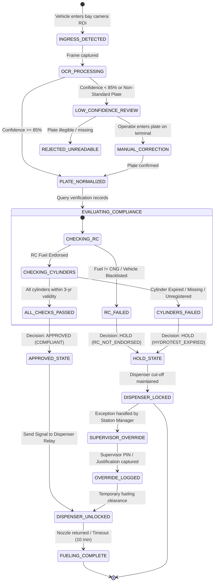

# Application Workflow & System Journey (AppFlow)

**Project Name:** SmartFuel — Commercial Enterprise CNG Dispensing & Safety Management Automation Platform  
**Developer & Provider:** SmartFuel Technologies Pvt. Ltd.  
**Document Reference:** SF-ENT-FLOW-2026-V2.0  
**Status:** Production Deployed (`https://fuel.cscsetu.com`)  
**Classification:** Proprietary / Commercial B2B  

---

## 1. End-to-End System Operational Journey

The core operational workflow governs the transition from physical vehicle ingress at a CNG station dispenser island to automated safety verification, physical dispenser solenoid interlock actuation, and permanent audit logging.

```mermaid
sequenceDiagram
    autonumber
    actor Driver as Vehicle Driver
    participant Cam as Island ANPR Camera
    participant Edge as Station Edge Gateway
    participant Cloud as SmartFuel Cloud Core
    participant Compliance as Compliance & Verification Engine
    participant Disp as Island Display (/cng-display)
    participant Relay as Dispenser Solenoid Relay
    actor Attendant as Forecourt Attendant

    Driver->>Cam: Pulls vehicle into Dispenser Bay
    Cam->>Edge: Continuous RTSP Frame Stream
    Note over Edge: Motion Trigger & Plate Localization<br/>Deskew + OCR Extraction (HSRP / BH)
    Edge->>Cloud: POST /api/v1/edge/scan (Plate, Snapshot, Confidence)
    Note over Cloud: Duplicate Suppression Check (180s)
    Cloud->>Compliance: Dual Verification Query (Plate)
    Compliance-->>Cloud: Vehicle Records (Fuel Endorsement) + Cylinder Records (Hydrotest Validity)
    Note over Cloud: Compliance Decision Engine Evaluates Safety Rules
    
    alt Both Checks Pass (Compliant)
        Cloud-->>Edge: Decision = APPROVED
        Edge->>Disp: Display GREEN (APPROVED / अनुमत)
        Edge->>Relay: Energize Solenoid Relay (UNLOCK 24V)
        Attendant->>Driver: Connects Nozzle & Dispenses CNG
    else Either Check Fails (Expired / Non-Endorsed)
        Cloud-->>Edge: Decision = HOLD
        Edge->>Disp: Display RED (HOLD / रोका गया + Reason)
        Edge->>Relay: De-energize Relay (CUT SOLENOID POWER)
        Attendant->>Driver: Refuses Fueling; Directs to Safety Office
    else Uncertain Plate / Low Confidence (<85%)
        Cloud-->>Edge: Decision = UNDER REVIEW
        Edge->>Disp: Display AMBER (REVIEW / समीक्षा)
        Edge->>Relay: Maintain Interlock (LOCKED)
        Attendant->>Attendant: Verifies plate manually on Station Terminal
    end
    
    Cloud->>Cloud: Write Cryptographic Audit Ledger & Event Log
```

---

## 2. Vehicle Inspection State Machine

The verification lifecycle transitions through strictly deterministic states. No vehicle may reach `APPROVED` without satisfying both registration fuel endorsement and 3-year hydrostatic cylinder validity rules.



---

## 3. Detailed Role-Based User Journeys

### 3.1 Journey A: Forecourt Attendant (On-Island Operation)
1. **Station Login:** Attendant authenticates via forecourt terminal or mobile tablet using Station ID and Operator PIN.
2. **Shift Assignment:** Selects assigned dispenser bay (e.g., *Island 2, Bay A & B*).
3. **Passive Surveillance:** Overhead monitor continuously runs `/cng-display` in full-screen mode, showing station readiness banner.
4. **Vehicle Arrival:** As a vehicle stops at the dispenser, the monitor updates within 1.2 seconds:
   - If **GREEN:** Attendant hears confirmation chime, verifies that the plate on screen matches physical vehicle, plugs nozzle, and begins dispensing.
   - If **RED:** High-intensity red alert shows specific failure reason (e.g., *Cylinder Expired: WB00DE0001*). Dispenser keypad remains unresponsive (solenoid locked). Attendant explains safety rejection to driver.
   - If **AMBER:** Attendant checks plate number on the companion handheld/wall tablet, taps *Confirm Plate* if OCR was slightly misread, or directs vehicle to supervisor.

---

### 3.2 Journey B: Station Safety Supervisor (Exception & Override Handling)
1. **Alert Notification:** Station Manager console alerts on an active `HOLD` incident.
2. **Inspection Review:** Supervisor inspects the live event in the portal (`/` or `/alerts/wall`):
   - Inspects vehicle ingress camera photo.
   - Inspects vehicle compliance records and registered chassis number.
   - Inspects cylinder testing history and certificate records.
3. **Driver Dispute Resolution:** Driver claims cylinder was recently tested and shows a physical paper certificate:
   - Supervisor cross-checks certificate QR code against accredited testing agency database.
   - If the certificate is genuine but pending central database synchronization:
     - Supervisor clicks **Initiate Emergency Manual Override**.
     - System prompts for: Mandatory Reason Code, Justification Notes, Photo upload of physical certificate, and Supervisor Digital PIN.
   - System unlocks dispenser for a single 15-minute dispensing session and issues an immediate critical audit entry to the Corporate CGD Safety Auditor.

---

### 3.3 Journey C: Corporate CGD Safety Auditor & Operations Director
1. **Enterprise Overview:** Accesses high-level analytics dashboard at `/analytics` and `/reports`:
   - Total vehicles scanned today across national franchise network.
   - Compliance Rate (% Approved vs % Rejected).
   - Top rejection causes (RC Not Endorsed vs Hydrotest Expired vs Blacklisted).
2. **Station Safety Ranking:** Views stations with highest violation attempts or abnormal supervisor override frequencies.
3. **Blacklist Propagation:** Adds a known counterfeit cylinder serial or stolen vehicle plate to the Enterprise Blacklist; all edge gateways synchronize within 60 seconds.
4. **Audit Export:** Generates official statutory compliance report PDF for corporate safety filings and insurance risk underwriting.

---

## 4. Edge-Cases & Fallback Error Workflows

| Operational Edge Case | Root Cause | Automated System Handling | Fail-Safe State |
| :--- | :--- | :--- | :--- |
| **Complete Network Outage** | Fiber cut / Telecom 4G failure at remote station. | Edge gateway automatically switches to **Local Station Offline Cache**. Vehicles scanned in last 30 days are validated locally. Uncached vehicles show `UNDER REVIEW`. | Failsafe: Dispenser remains locked for uncached cars until supervisor approves. |
| **Muddy / Damaged Plate** | Road dirt or damaged physical number plate. | ANPR confidence drops below 85%. Island display shows `AMBER: MANUAL VERIFICATION`. Attendant types confirmed plate into tablet. | Interlock remains LOCKED until operator confirms correct plate. |
| **Multi-Cylinder Vehicle (e.g., Bus / Dual Tank Car)** | Commercial buses or modern dual-tank cars have 2 to 4 cylinders. | System verifies **every individual cylinder serial**. If Cylinder 1 is valid until 2028 but Cylinder 2 expired yesterday, outcome is strictly `HOLD`. | LOCKED (All cylinders must pass). |
| **Plate Swapping Fraud** | Stolen/valid plate affixed onto an uncertified car. | Ingress snapshot is compared against registered make/model/color in compliance database. If plate belongs to a Maruti WagonR but camera detects a Hyundai Creta, system triggers `FLAG: MAKE_MODEL_MISMATCH`. | HOLD / FRAUD ALERT. |
| **Two-Wheeler Enters Bay** | Motorcycle cuts across CNG dispensing bay. | AI vehicle-type classifier detects motorcycle/scooter class. Discards trigger without creating a false vehicle entry log. | Ignored (Dispenser not energized). |
| **Dispenser Solenoid Tampering** | Attendant manually jumps electrical relay bypass. | SmartFuel edge sensor monitors nozzle flowmeter pulse lines. If gas flow is detected while SmartFuel state is `HOLD`, system sounds loud on-site siren and sends instant tamper alert to Central Operations. | TAMPER ALARM FIRED. |
