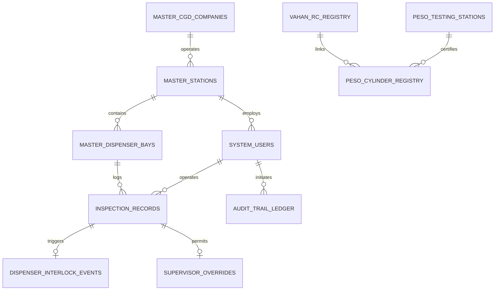

# Database Architecture & Relational Schema (BackendSchema)

**Project Name:** SmartFuel — National Automated CNG Safety & Compliance Verification System  
**Database Engine:** PostgreSQL 16 Enterprise / Relational Architecture with Partitioning  
**Document Reference:** SF-GOV-DB-2026-V1.0  
**Status:** Approved for Implementation  
**Classification:** Official / Restricted  

---

## 1. Entity-Relationship (ER) Architecture Overview

The SmartFuel relational schema models regulatory oversight, organizational hierarchy (Ministry -> CGD -> Retail Station -> Dispenser Bay), dual vehicle verification data (MoRTH VAHAN & PESO), live inspection telemetry, hardware interlocks, and an immutable cryptographic audit ledger.



---

## 2. Table Schemas & Data Definition Language (DDL)

### 2.1 Organizational & Master Hierarchy

```sql
-- 1. City Gas Distribution (CGD) Authorized Entities (e.g., IGL, MGL, GAIL Gas, IOCL)
CREATE TABLE master_cgd_companies (
    id SERIAL PRIMARY KEY,
    company_code VARCHAR(20) UNIQUE NOT NULL,      -- e.g., 'IGL', 'MGL', 'GAIL_GAS'
    company_name VARCHAR(150) NOT NULL,
    cin_number VARCHAR(30) UNIQUE,
    headquarters_city VARCHAR(100) NOT NULL,
    nodal_officer_email VARCHAR(255) NOT NULL,
    nodal_officer_phone VARCHAR(20) NOT NULL,
    active BOOLEAN DEFAULT TRUE NOT NULL,
    created_at TIMESTAMPTZ DEFAULT CURRENT_TIMESTAMP NOT NULL
);

-- 2. Retail CNG Stations (Licensed by PESO & CGD Entity)
CREATE TABLE master_stations (
    id SERIAL PRIMARY KEY,
    cgd_company_id INT NOT NULL REFERENCES master_cgd_companies(id) ON DELETE RESTRICT,
    station_code VARCHAR(30) UNIQUE NOT NULL,       -- e.g., 'IGL-DL-RO-0104'
    station_name VARCHAR(160) NOT NULL,
    peso_station_license VARCHAR(60) UNIQUE NOT NULL,-- e.g., 'PESO/DL/CNG/2019/8491'
    address TEXT NOT NULL,
    city VARCHAR(100) NOT NULL,
    district VARCHAR(100) NOT NULL,
    state_code VARCHAR(2) NOT NULL,                 -- e.g., 'DL', 'WB', 'MH'
    pin_code VARCHAR(6) NOT NULL,
    latitude DECIMAL(10, 7),
    longitude DECIMAL(10, 7),
    active BOOLEAN DEFAULT TRUE NOT NULL,
    created_at TIMESTAMPTZ DEFAULT CURRENT_TIMESTAMP NOT NULL
);

-- 3. Dispenser Islands & Bays (Hardware Association)
CREATE TABLE master_dispenser_bays (
    id SERIAL PRIMARY KEY,
    station_id INT NOT NULL REFERENCES master_stations(id) ON DELETE CASCADE,
    bay_number INT NOT NULL,                        -- e.g., Bay 1, Bay 2
    island_number INT NOT NULL,                     -- e.g., Island 1
    camera_rtsp_url_hash VARCHAR(64),               -- Salted hash of camera RTSP stream URL
    edge_device_id VARCHAR(50) UNIQUE NOT NULL,     -- Hardware UUID of Station Edge Mini-PC
    interlock_relay_ip VARCHAR(45) NOT NULL,        -- Local IP of MODBUS relay controller
    interlock_relay_channel INT NOT NULL,           -- Relay channel wiring to dispenser solenoid
    active BOOLEAN DEFAULT TRUE NOT NULL,
    last_heartbeat TIMESTAMPTZ,
    CONSTRAINT uq_station_bay UNIQUE (station_id, bay_number)
);
```

---

### 2.2 Role-Based Access Control (RBAC)

```sql
-- 4. Authorized System Users (Operators, Supervisors, CGD Auditors, Ministry Regulators)
CREATE TABLE system_users (
    id SERIAL PRIMARY KEY,
    email VARCHAR(255) UNIQUE NOT NULL,
    phone_number VARCHAR(15) UNIQUE,
    password_hash VARCHAR(255) NOT NULL,
    full_name VARCHAR(120) NOT NULL,
    role VARCHAR(30) NOT NULL CHECK (
        role IN ('super_admin', 'peso_auditor', 'cgd_admin', 'station_supervisor', 'bay_attendant')
    ),
    cgd_company_id INT REFERENCES master_cgd_companies(id) ON DELETE SET NULL,
    station_id INT REFERENCES master_stations(id) ON DELETE SET NULL,
    aadhaar_masked VARCHAR(12),                     -- e.g., 'XXXX-XXXX-1234'
    active BOOLEAN DEFAULT TRUE NOT NULL,
    credential_version VARCHAR(32) NOT NULL DEFAULT 'v1',
    created_at TIMESTAMPTZ DEFAULT CURRENT_TIMESTAMP NOT NULL
);

-- 5. Revoked / Terminated Sessions (Zero Trust Invalidation)
CREATE TABLE revoked_sessions (
    token_sha256 VARCHAR(64) PRIMARY KEY,
    user_id INT NOT NULL REFERENCES system_users(id) ON DELETE CASCADE,
    revoked_at TIMESTAMPTZ DEFAULT CURRENT_TIMESTAMP NOT NULL,
    expires_at TIMESTAMPTZ NOT NULL
);
CREATE INDEX idx_revoked_expiry ON revoked_sessions (expires_at);
```

---

### 2.3 Regulatory Registries (MoRTH VAHAN & PESO Hydrotest)

```sql
-- 6. MoRTH VAHAN 4.0 Vehicle RC Registry (National Mirror / Cache)
CREATE TABLE vahan_rc_registry (
    plate_number VARCHAR(16) PRIMARY KEY,           -- e.g., 'DL01AB1234', '22BH1234AA'
    chassis_number VARCHAR(30) NOT NULL,            -- Encrypted at application layer
    engine_number VARCHAR(30) NOT NULL,
    make_model VARCHAR(120) NOT NULL,               -- e.g., 'Maruti Suzuki WagonR LXi CNG'
    vehicle_class VARCHAR(40) NOT NULL,             -- 'LMV', 'Three Wheeler (Auto)', 'Bus'
    fuel_type VARCHAR(30) NOT NULL,                 -- Must be 'CNG', 'PETROL/CNG', 'DIESEL/CNG'
    cng_endorsed BOOLEAN NOT NULL DEFAULT FALSE,    -- Official MoRTH endorsement flag
    cng_endorsement_date DATE,
    rc_status VARCHAR(20) NOT NULL DEFAULT 'ACTIVE',-- 'ACTIVE', 'SUSPENDED', 'CANCELLED', 'STOLEN'
    owner_masked VARCHAR(60) DEFAULT '',            -- e.g., 'R*** K***' (DPDP compliant)
    state_code VARCHAR(2) NOT NULL,
    is_blacklisted BOOLEAN DEFAULT FALSE NOT NULL,
    blacklist_reason VARCHAR(255),
    last_sync_with_vahan TIMESTAMPTZ DEFAULT CURRENT_TIMESTAMP NOT NULL
);
CREATE INDEX idx_vahan_cng_status ON vahan_rc_registry (cng_endorsed, rc_status);

-- 7. PESO Accredited Testing Stations (Authorized Cylinder Testing Facilities)
CREATE TABLE peso_testing_stations (
    id SERIAL PRIMARY KEY,
    peso_license_number VARCHAR(60) UNIQUE NOT NULL,-- e.g., 'PESO/HQ/CYL/TEST/2021/119'
    facility_name VARCHAR(160) NOT NULL,
    address TEXT NOT NULL,
    district VARCHAR(100) NOT NULL,
    state_code VARCHAR(2) NOT NULL,
    license_valid_till DATE NOT NULL,
    active BOOLEAN DEFAULT TRUE NOT NULL,
    created_at TIMESTAMPTZ DEFAULT CURRENT_TIMESTAMP NOT NULL
);

-- 8. PESO Central Cylinder Hydrotest Registry (Rule 35, Gas Cylinders Rules 2016)
CREATE TABLE peso_cylinder_registry (
    id SERIAL PRIMARY KEY,
    cylinder_serial_number VARCHAR(80) NOT NULL,    -- Stamped cylinder serial
    plate_number VARCHAR(16) NOT NULL REFERENCES vahan_rc_registry(plate_number) ON DELETE CASCADE,
    manufacturer_name VARCHAR(120) NOT NULL,        -- e.g., 'EKC', 'Rama Cylinders', 'Confidence'
    water_capacity_liters DECIMAL(5, 2) NOT NULL,   -- e.g., 60.00 Liters
    working_pressure_bar INT DEFAULT 200 NOT NULL,
    test_pressure_bar INT DEFAULT 300 NOT NULL,
    last_hydrotest_date DATE NOT NULL,              -- Date of physical stretch test
    hydrotest_expiry_date DATE NOT NULL,           -- Exactly 3 years from last test
    test_certificate_number VARCHAR(100) NOT NULL,  -- Statutory certificate number
    testing_station_id INT NOT NULL REFERENCES peso_testing_stations(id),
    status VARCHAR(20) NOT NULL DEFAULT 'VALID',    -- 'VALID', 'EXPIRED', 'CONDEMNED', 'SUSPECT'
    created_at TIMESTAMPTZ DEFAULT CURRENT_TIMESTAMP NOT NULL,
    CONSTRAINT uq_cylinder_plate_serial UNIQUE (plate_number, cylinder_serial_number)
);
CREATE INDEX idx_cylinder_plate ON peso_cylinder_registry (plate_number);
CREATE INDEX idx_cylinder_expiry ON peso_cylinder_registry (hydrotest_expiry_date);
```

---

### 2.4 Live Ingress Inspection & Dispenser Interlock Telemetry

```sql
-- 9. Ingress Inspection Records (Time-Range Partitioned for High Volume)
CREATE TABLE inspection_records (
    id BIGSERIAL NOT NULL,
    station_id INT NOT NULL REFERENCES master_stations(id),
    bay_number INT NOT NULL,
    scanned_at TIMESTAMPTZ NOT NULL DEFAULT CURRENT_TIMESTAMP,
    recognized_plate VARCHAR(16) NOT NULL,
    confirmed_plate VARCHAR(16) NOT NULL,
    ocr_confidence DECIMAL(5, 2) NOT NULL,          -- e.g., 96.40%
    capture_method VARCHAR(40) NOT NULL,            -- 'automatic_anpr_camera', 'manual_plate_entry'
    vahan_rc_status VARCHAR(20) NOT NULL,           -- 'PASS', 'FAIL', 'NOT_FOUND'
    peso_hydrotest_status VARCHAR(20) NOT NULL,     -- 'PASS', 'EXPIRED', 'MISSING_CERT'
    final_decision VARCHAR(20) NOT NULL,           -- 'APPROVED', 'HOLD', 'REVIEW'
    decision_reason TEXT NOT NULL,
    snapshot_storage_path VARCHAR(255),             -- S3 / MinIO object key
    operator_id INT REFERENCES system_users(id),
    created_at TIMESTAMPTZ NOT NULL DEFAULT CURRENT_TIMESTAMP,
    PRIMARY KEY (id, scanned_at)
) PARTITION BY RANGE (scanned_at);

-- Partition Tables by Year/Month (Sample: Year 2026 Monthly Partitions)
CREATE TABLE inspection_records_2026_10 PARTITION OF inspection_records
    FOR VALUES FROM ('2026-10-01 00:00:00+00') TO ('2026-11-01 00:00:00+00');
CREATE TABLE inspection_records_2026_11 PARTITION OF inspection_records
    FOR VALUES FROM ('2026-11-01 00:00:00+00') TO ('2026-12-01 00:00:00+00');

CREATE INDEX idx_inspections_plate_time ON inspection_records (confirmed_plate, scanned_at DESC);
CREATE INDEX idx_inspections_station_decision ON inspection_records (station_id, final_decision);

-- 10. Hardware Dispenser Interlock Relay Execution Logs
CREATE TABLE dispenser_interlock_events (
    id BIGSERIAL PRIMARY KEY,
    inspection_id BIGINT NOT NULL,
    scanned_at TIMESTAMPTZ NOT NULL,
    bay_number INT NOT NULL,
    relay_command VARCHAR(20) NOT NULL,             -- 'UNLOCK_SOLENOID', 'LOCK_SOLENOID'
    hardware_ack_status VARCHAR(20) NOT NULL,       -- 'SUCCESS', 'TIMEOUT', 'RELAY_FAULT'
    response_latency_ms INT NOT NULL,               -- Relay response time in milliseconds
    executed_at TIMESTAMPTZ DEFAULT CURRENT_TIMESTAMP NOT NULL
);

-- 11. Station Supervisor Manual Overrides (Accountability & Audit)
CREATE TABLE supervisor_overrides (
    id SERIAL PRIMARY KEY,
    inspection_id BIGINT NOT NULL,
    scanned_at TIMESTAMPTZ NOT NULL,
    supervisor_id INT NOT NULL REFERENCES system_users(id),
    reason_code VARCHAR(40) NOT NULL CHECK (
        reason_code IN ('OFFLINE_PHYSICAL_CERT_VERIFIED', 'EMERGENCY_AMBULANCE_CLEARANCE', 'PORTAL_SYNC_DELAY')
    ),
    justification TEXT NOT NULL,
    physical_certificate_upload_path VARCHAR(255),
    supervisor_otp_aadhaar_ref VARCHAR(64) NOT NULL,
    approved_at TIMESTAMPTZ DEFAULT CURRENT_TIMESTAMP NOT NULL
);
```

---

### 2.5 Tamper-Evident Cryptographic Audit Ledger

```sql
-- 12. Immutable Audit Trail Ledger (Chained SHA-256 Hashes)
CREATE TABLE audit_trail_ledger (
    sequence_id BIGSERIAL PRIMARY KEY,
    happened_at TIMESTAMPTZ DEFAULT CURRENT_TIMESTAMP NOT NULL,
    actor_id INT REFERENCES system_users(id),
    actor_ip VARCHAR(45) NOT NULL,
    action_code VARCHAR(80) NOT NULL,               -- e.g., 'INSPECTION_DECISION', 'SUPERVISOR_OVERRIDE'
    subject_entity VARCHAR(80) NOT NULL,            -- e.g., 'plate:DL01AB1234', 'user:admin@igl.in'
    event_details JSONB NOT NULL,
    previous_record_hash VARCHAR(64) NOT NULL,      -- SHA-256 hash of previous row
    current_record_hash VARCHAR(64) NOT NULL        -- SHA-256(prev_hash || timestamp || action || payload)
);
CREATE INDEX idx_audit_happened ON audit_trail_ledger (happened_at DESC);
```

---

## 3. Data Retention & Regulatory Archival Strategy

| Data Category | Operational Hot Tier | Cold Archive Tier | Statutory Retention Period |
| :--- | :--- | :--- | :--- |
| **Inspection Telemetry** | 90 Days in PostgreSQL NVMe | S3 Glacier Deep Archive (CSV/Parquet) | 5 Years (PESO Audit Mandate) |
| **Camera Ingress Images** | 30 Days in Fast Object Storage | Compressed JPEG (80% quality) in S3 | 1 Year (Law Enforcement Mandate) |
| **Audit Ledger & Overrides** | Permanent Hot Storage | Replicated to Write-Once-Read-Many (WORM) | Indefinite (Non-expiring legal record) |
| **Cylinder Test Records** | Active until cylinder re-tested | Preserved in Historical Ledger | 15 Years (Full lifecycle of cylinder) |
